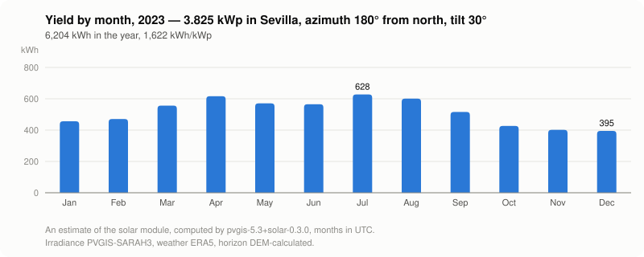
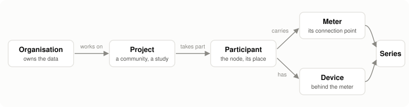

# Nexgen OS

Nexgen OS is an open digital twin of energy places — organisations, projects, participants, their meters, devices and series — driven by AI agents that work as users of the model
([0039](docs/decisions/0039-an-agent-is-a-user-of-the-model.md)).

Nexgen OS is the open foundation and the reference language; commercial
platforms may be built on it, and this repository describes the
foundation. Why the foundation exists and what it promises:
[MANIFESTO.md](MANIFESTO.md). Where the open foundation stops and the
services around it begin: [docs/services.md](docs/services.md). What the
figures are and are not: [DISCLAIMER.md](DISCLAIMER.md).

> Status: **0.3.0**, the first release — the core schema, the `building`,
> `grid`, `community`, `billing`, `consumption`, `weather`, `solar`,
> `battery`, `charging`, `kpis` and `actions` modules, the format libraries,
> the weather, geocoding and meter data connectors, program connectors in
> any language with pvlib (Python) as the first, the `nexgen-os` installer,
> the MCP server, the Python client, the `fr`, `be` and `es` country packs
> and seven example datasets; each is described in
> the [changelog](CHANGELOG.md). Tested; names may still change until 1.0
> ([road to 1.0](docs/road-to-1.0.md)), and every change is written down.

## For a solar developer

Nexgen OS computes, sizes and documents a PV project, from the roof to
the energy shared in a community, in a database you own. Every figure
says which weather, period, models and losses it was computed with, so
that a lender, a reviewer or a client can check it.



- **A yield with its provenance**: PVGIS (no key), PVWatts built in, or
  pvlib through its connector; P50 and the exceedance levels asked for,
  IEC 61724-1 indicators, an ordered loss chain, a far horizon and the
  soiling of the place ([`modules/solar`](modules/solar/README.md)).
- **Products from their files**: PAN and OND read into module and
  inverter products, with pvlib's parameter names
  ([`packages/formats/panond`](packages/formats/panond/README.md)).
- **Sizing on a measured curve**: the PV power that best meets a
  self-consumption rate, a self-sufficiency, a net present value or a
  payback, bounded by the roof faces of the place
  ([`size()`](modules/solar/README.md#sizing-size)).
- **Production apart from the meter**: a meter measures offtake and
  injection, a PV system its production; the core refuses one for the
  other.
- **Batteries, chargers and energy sharing** in their modules
  ([`battery`](modules/battery/README.md),
  [`charging`](modules/charging/README.md),
  [`community`](modules/README.md)), meter data from Enedis R6x files
  and SGE, and the rules of France, Belgium and Spain as country packs
  with worked cases ([`packs/`](packs/)).

Try it first without a database or an account: in a clone of this
repository (`npm ci` once), one command installs the core and the
`solar` module in a Postgres in memory, loads the house of example 01,
computes its yield for a year through PVGIS (no key, an Internet
connection) and prints it by month with what the estimate was computed
from; nothing is kept.

```bash
npx tsx modules/cli.ts try --year 2023
```

Example projects with varied energy assets, each a SQL file that loads
as is and ends with the queries a page would run, are in
[`docs/demo/`](docs/demo/README.md):

| Example | Assets |
|---|---|
| [`01-house-pv-battery.sql`](docs/demo/01-house-pv-battery.sql) | a house with PV behind its meter, an inverter, a smart meter, a planned battery |
| [`02-school.sql`](docs/demo/02-school.sql) | a school with rooms, multisensors and a heat pump with its setpoints |
| [`03-energy-community.sql`](docs/demo/03-energy-community.sql) | an energy community: four participants and their meters, a producer |
| [`04-farm-solar.sql`](docs/demo/04-farm-solar.sql) | a farm with roof, ground and carport PV, offtake and injection meters, a PVGIS estimate |
| [`05-district-open-data.sql`](docs/demo/05-district-open-data.sql) | a district from open data: plots and buildings |
| [`06-drone-survey.sql`](docs/demo/06-drone-survey.sql) | roof faces measured by a drone survey |
| [`07-office-heating.sql`](docs/demo/07-office-heating.sql) | an office with a boiler, a heat pump and a planned replacement |

The path from an empty database to a house with its yearly yield is
[below](#twenty-minutes-to-the-same-house-with-its-yield). Connectors and
format libraries are MIT and can live inside any product; the
[licence](#licence) says what the AGPL asks of the core.

## The model in one screen

Six objects, in the order a page walks them — the organisation, the
project it works on, the participants taking part in it, the meters they
carry, the devices behind those meters, the series they produce — and
what is attached to them, in the schema `nexgen`. In plain words:



- **the organisation** owns the data and has members;
- **the project** is what a person works on — a community, a set of buildings, a study, a district plan;
- **the participant** is the node: an actor with its address and its point on the map, every module links to it;
- **the meter** is its connection point to a network, the frontier between the grid and the place;
- **the device** is what it has behind the meter — a PV system, a battery, a charger, a heat pump, a probe;
- **the series** is a quantity of any of them over time, as many per device as it measures.

The physical description of a place — its ground, buildings, floors, rooms
and roof faces — enriches the participant in the `building` module; a
device belongs to its participant ([0043](docs/decisions/0043-the-participant-is-the-node.md)).

Three rules shaped this structure, and settle every new question about it:
**keep it simple**; **few words** — one word per thing across schemas,
folders and documents (the meter is `meters` in the core and `grid.meters`
in the grid module); and **stay close to the platform this core was taken
from**, whose structure has proven itself in the field. The table that groups the
core's tables, the functions that act on them and the standards they follow
is in [supabase/README.md](supabase/README.md); the diagram and the rules are in
[docs/model.md](docs/model.md); the rules and why in
[docs/doctrine.md](docs/doctrine.md).

## Principles

1. **Six concrete objects, few tables.** A participant is a row of
   `participants`, a building a row of `building.buildings`, and the
   hierarchy is their foreign keys. An attribute, an identifier, a document
   or a series names one of the six objects of the core by its kind and its
   id (`('participant', id)`), checked by a plain constraint; the core is
   thirty-four tables and one view. A new kind of thing is a
   module table with its own columns; a new attribute type is a vocabulary row; a
   new API is a source row.
2. **3D WGS 84 everywhere.** Any CRS is accepted on the way in; geometry is
   stored in EPSG:4326 with heights in metres, and measured in the UTM zone it
   falls in, anywhere on earth.
3. **One way to read, one way to write.** `attributes_of()` for attributes,
   `resample()` for series (the amount of each bucket, a register's
   consumption included; `window()`, `latest()`, `fill()`, `forecast_at()`
   beside it), `participant_of(kind, id)` and `country_of(kind, id)` for whose and where, `building.building_volume()`
   for a derived 3D block. Values are written by `store()` alone, which
   converts their unit, checks their quality and step, and refreshes the
   aggregates; clients never resample, convert or fill.
4. **Deterministic core, operable by an agent.** Nothing in the core calls a
   model; a module keeps what it computes in a table named after it (`solar.estimates`,
   `community.settlements`), each row with its inputs and its provenance: a
   figure says where it comes from. On top of it, an AI agent works as a user of the
   model — the same tables, the same rights, the same refusals by name — so
   that describing and studying a place can be delegated without the data
   leaving its owner ([AGENTS.md](AGENTS.md)).
5. **Modules in their own schema, countries as data, formats by format,
   invoices in Ekwo OS** ([why](#invoicing-and-ekwo-os)).

## Install

On an empty Supabase project with PostGIS enabled
(`create extension if not exists postgis with schema extensions;`):

```bash
export NEXGEN_DB_URL='postgresql://…'   # the project's connection string
npx nexgen-os init --dry-run            # what would be applied
npx nexgen-os init                      # the core and every module; --packs <cc> for a country
npx nexgen-os doctor                    # what is wrong, by name
```

Program connectors are optional: a yield computed by pvlib needs Python and
`packages/connectors/pvlib` installed, as [`packages/connectors/README.md`](packages/connectors/README.md#programs-in-any-language) says.

From Python, the client reads the model and attaches with a source:
[`packages/python/README.md`](packages/python/README.md).

The installer and its commands: [`packages/cli/README.md`](packages/cli/README.md).
How a release is cut: [`docs/releasing.md`](docs/releasing.md).

## With an AI agent

An agent works on the model as the person who asked it, under row level
security ([0039](docs/decisions/0039-an-agent-is-a-user-of-the-model.md)),
through the MCP server [`@nexgen-os/mcp`](packages/mcp/README.md):

```bash
npx nexgen-os key create --organisation <id> --name "My agent"   # as an owner (NEXGEN_ACT_AS_USER_ID or NEXGEN_ACCESS_TOKEN); --write to let it write
```

```json
{ "mcpServers": { "nexgen": { "command": "npx", "args": ["-y", "@nexgen-os/mcp@latest"],
  "env": { "NEXGEN_DB_URL": "postgresql://…", "NEXGEN_API_KEY": "ngk_…" } } } }
```

It reads, and writes only when the person allows it; it refuses a
`service_role` key; it offers the tools of the core and of the modules
installed — describe a participant, import its readings, size, estimate,
settle, propose. The same server runs over Streamable HTTP with the OAuth
discovery a remote client follows, for whoever hosts it. What an agent does
here, and never does: [`AGENTS.md`](AGENTS.md).

## Run the tests

```bash
npm install
npm test        # PGlite + PostGIS in WebAssembly, no server needed
npm run typecheck
```

The tests describe real cases end to end: a house (a participant with its
place and its meter, a building, a roof face, a PV system derived by a module, attributes over time, documents),
a school (floors and rooms as one tree of spaces, a multisensor whose
readings are series, setpoints asked of a heat pump), an energy community on
the core's projects, participants and meters (participants carrying their
place and their meter, contacts, groups, meter swap, cumulative register, a
place in two projects), a district
from open data (projected CRS, OSM identifiers, spatial queries), the
exact list of the tables of the core, the cascade of defaults, security (row level security, viewers, a module's figures,
vocabulary hygiene), the series store across a clock change, the weather
and solar modules with a yield estimate on PVGIS, on `pvwatts.ts` and on the
pvlib connector, the format libraries in and out without losing a field, the
three country packs and the installer. Every dataset in `docs/demo/` loads and
is checked.

## Five minutes, from an empty project to a building

1. On an empty [Supabase](https://supabase.com) project, enable PostGIS in
   the SQL editor: `create extension if not exists postgis with schema extensions;`
2. Keep the connection string in the environment, never in a file:
   `export NEXGEN_DB_URL='postgresql://postgres.<ref>:<password>@<host>:5432/postgres'`
3. Install the core, every module and the pack of the country you work in:
   `npx nexgen-os init --packs <country code>` (`--dry-run` first shows what
   would be applied and rolls it back).
4. Check it: `npx nexgen-os doctor` names every problem, or none.
5. Load a dataset: `psql -v ON_ERROR_STOP=1 "$NEXGEN_DB_URL" -c 'set search_path = nexgen, extensions' -f docs/demo/01-house-pv-battery.sql`
   (PostGIS lives in the schema `extensions` on Supabase),
   then ask it something:

   ```sql
   set search_path = nexgen;
   select d.name, d.device_type, m.identifier meter
   from devices d left join meters m on m.participant_id = d.participant_id
   where d.status <> 'planned'
   order by d.name;
   ```

The installer's page ([packages/cli/README.md](packages/cli/README.md))
says what each command does and how to reach a remote host over TLS. Every
dataset in `docs/demo/` is a complete, loadable dataset.

## Twenty minutes, to the same house with its yield

From the house loaded above, in a clone of this repository (`npm ci` once):

6. Describe its PV system in the `solar` module, with one array facing
   south at 30°, its own azimuth and tilt:

   ```sql
   set search_path = nexgen;
   insert into solar.devices (id, kwp_dc, grid_connection) values ('00000000-0000-4000-8000-000100000051', 3.825, 'self_consumption');
   insert into solar.pv_arrays (organisation_id, device_id, name, azimuth_deg, tilt_deg, mounting, kwp_dc) values ('00000000-0000-4000-8000-000100000001', '00000000-0000-4000-8000-000100000051', 'South roof', 180, 30, 'roof_parallel', 3.825);
   ```

7. Compute its yield for a year, as an estimate: PVGIS computes the energy (no
   key), the estimate records the weather, the period, the array, the losses and
   the conventions, and the hourly energy is read back by month through
   `resample()`:

   ```bash
   npx tsx docs/demo/yield.ts 00000000-0000-4000-8000-000100000051 2023
   ```

8. Read what the estimate says it was computed from: its provenance, the
   weather and the arrays it read.

   ```sql
   select provenance, inputs->'weather', inputs->'arrays', results
     from solar.estimates where device_id = '00000000-0000-4000-8000-000100000051'
    order by updated_at desc limit 1;
   ```

The yield profiles, the other ways to compute one (`pvwatts`, the pvlib connector)
and what each estimate records: [modules/solar/README.md](modules/solar/README.md).

## Layout

```
supabase/              the core: migrations in the schema `nexgen` (`public` stays the installation's), the vocabularies and the country seeds, the model in one screen
modules/               one Postgres schema per module (actions, billing, building, charging, community, consumption, grid, kpis, solar, battery, weather): its manifest `module.json`, its `supabase/migrations/`, its `src/` and its `tests/`
packs/                 one folder per country, data only (fr, be, es: identity and regions, identifiers, sources, frames of projects, municipalities, grid operators, defaults, golden cases), and the schema they are written against
packages/cli/          the installer, `nexgen-os`: init, migrate, doctor, status, pack build and check, try in memory, and the gestures of the model as a person
packages/mcp/          `@nexgen-os/mcp`: the MCP server, over stdio and Streamable HTTP, acting as the person
packages/core/         `@nexgen-os/core`: the database seam, the standard place and the geocoder chain, the series API, the connector interfaces and the runner of the program connectors
packages/formats/      one MIT package per file format (cityjson, energy-bill, enedis-r6x, geojson, homeassistant, ifc, ocpp, panond, parquet, weather-files)
packages/connectors/   code that reaches outside, MIT: one package per outside service, weather (open-meteo, pvgis), geocoders (nominatim, photon, ban, geopunt, urbis, icar, mapbox), meter data under mandate (switchgrid, enedis-sge), and the programs in other languages, JSON in and out (pvlib, optional)
packages/python/       the Python client: the readers of the model, attributes attached with their source, MIT
docs/                  the model, the doctrine and its decisions, the road to 1.0, how a release is cut, and in `demo/` one loadable dataset per domain (house, school, community, farm, district, drone survey, office)
scripts/               hygiene, and what a release publishes
tests/                 the tests of the core, the demo datasets, the packs, the packages and the connectors; a module's are in its folder
```

## Help

Questions and bugs about the foundation go to the issues of this
repository. Installation, a module or a pack for a country, an integration,
a research partnership or training are services around the foundation
([docs/services.md](docs/services.md)); nothing in it is held back to make
them necessary.

## Invoicing, and Ekwo OS

Nexgen OS describes places, devices and series, and computes what moved and
at what price. The core gives who takes part in a project, behind which meter; the
[`community`](modules/README.md) module gives who received how much: allocation keys, and the volume of each participant over each
interval. A settlement program
([`packages/connectors/README.md`](packages/connectors/README.md#programs-in-any-language))
turns those volumes and the prices it is given — a supply, an injection, a
physical or virtual PPA (power purchase agreement), an internal community
tariff — into settlement lines: over each interval, the energy, the price
and who pays whom.

That is where Nexgen OS stops. It keeps no invoice and no ledger: a
settlement line is handed to an invoicing application, and
[Ekwo OS](https://github.com/Ekwo-ai/ekwo-os) ([ekwo.ai](https://ekwo.ai)),
the open invoicing and bookkeeping core built on the same playbook, is the one it is built
for. The [`billing`](modules/billing/README.md) module is the bridge:
an organisation's Ekwo company, a contact's Ekwo contact, the details of a
contact that the invoicing side manages, so that the core holds no personal
data, and the Ekwo invoices of each participant, who is the one billed
([decision 0010](docs/decisions/0010-the-participant-is-billed-ekwo-os-keeps-the-invoice.md)).
The invoice is issued in Ekwo OS, and the bridge records it.

The two install side by side on one database: Nexgen OS takes the schema
`nexgen` and its modules; `public`, and `ekwo` from Ekwo OS 1.0, stay Ekwo's.
How to install both, and what the bridge needs when they share a database:
[docs/with-ekwo-os.md](docs/with-ekwo-os.md).

## Licence

The core, the modules, the packs and the installer are AGPL-3.0
([LICENSE](LICENSE)). The format libraries, the connectors and the
Python client are MIT, each folder with its own `LICENSE`, so that a reader or a connector
can live inside any product.

In practice: a product that reads and writes a Nexgen OS database through
its tables, its functions or the MCP server keeps its own licence; a
modified core or module offered to users over a network publishes its
changes under the AGPL.
