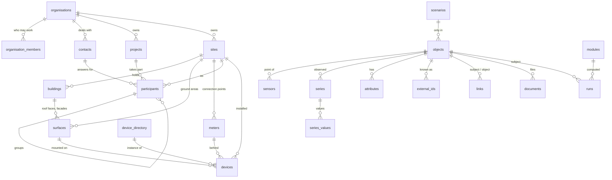

# The core model

`objects` is the registry: one row per project, site, building, surface,
meter, participant, device or sensor (and per floor or space of the
`architecture` module), with its kind, its organisation and its scenario.
The named tables keep it up to date by trigger. Attachments point to it;
pages read the named tables.

## Who

- **organisations** — the tenant, with its members (`owner`, `editor`,
  `viewer`). Its legal identity is its Ekwo company (`ekwo_company_id`).
- **contacts** — a person or a company: an owner, a tenant, an installer, a
  grid operator. An Ekwo contact (`ekwo_contact_id`): legal form, numbers,
  addresses, bank details and invoices live there.

## Where

- **projects** — a working perimeter (energy community, portfolio, study,
  district plan) with a country, a lifecycle (`simulation`, `creation`,
  `active`, `inactive`, `archived`) and, when it has one, a perimeter.
- **sites** — an address, a country, a parcel or a point, a profile (what it
  is used for). Everything on a site inherits its country: `country_of()`.
- **buildings** — footprint, elevation, height, floors, year, profile,
  lifecycle. `lod1_block()` extrudes the footprint.
- **surfaces** — a roof face, a facade, a ground area or a canopy, on a
  building or a site, with azimuth and tilt.

## The grid side

- **meters** — a connection point: identifier and scheme (checked against
  the scheme's pattern), commodity, direction, grid operator, validity. The
  physical meter is a device of type `meter` on it and can be swapped.
- **participants** — a site's role in a project: `producer`, `consumer` or
  `prosumer`, with the contact who answers for it, a status, a join and
  leave date (a site is in a project once at a time), and a parent for
  groups. `participant_meters()` gives the meters behind a participant,
  groups included.

## What

- **devices** — type (from `device_types`), site, building, surface and
  meter (all on the same site), catalogue product, manufacturer, model, rated
  power, unit count, geometry, status. A module derives the types it owns:
  `call derive_devices('energy.pv_systems', 'solar')` makes a table with the
  same id, refused for any other type.
- **device_directory** — products: manufacturer, model, unit power, capacity,
  surface, price. Shared rows (`organisation_id` null) come from modules and
  packs.
- **sensors** — a point of any object (`host_id`): quantity, kind (`sensor`,
  `setpoint`, `command`), the address a connector reads it at.

## Attached to any object

- **attributes** — one row per property and validity period, typed by
  `property_defs` (datatype, unit, range, allowed values, kinds it applies
  to). History is kept by closing a period and opening the next; two values
  never overlap in the same scenario. Read with `attributes_of(object, at,
  scenario)`.
- **external_ids** — unique per scheme in an organisation, checked against
  the scheme's pattern, with validity.
- **links** — typed and dated (`serves`, `shades`, `occupies`, `owns`…); the
  link type may require kinds on either side.
- **lineage** — splits, merges, replacements. Identifiers never encode
  anything and are never reused.
- **documents** — permit, datasheet, report, photo, video, plan: a URI, a
  media type, a source, a capture date. Heavy files stay in object storage.
  3D models and point clouds are the `3d` module's.
- **tags** — marker tags from `tags`, checked on write.

## Over time

- **series** — one quantity on one object, `measured`, `simulated`,
  `forecast` or `setpoint`; what one value means (`interval`, `instant`,
  `cumulative`); its step; the sensor that produces it; its source.
- **series_values** — the timestamped values of a series, with a quality flag.
  `resample(series, from, to, step)` is the one way series are read.
- **scenarios** — `scenario_id is null` is the world as it is. A scenario
  holds what a variant adds: objects, attributes that override reality,
  series. A scenario may build on another one.
- **runs** — `record_run(module, engine_version, subject, scenario, inputs,
  results)`: same identity, same run; a finished run never changes.

## Vocabularies

`device_types` (with the module that derives each), `profiles` (uses of a
building or a site), `link_types`, `quantities` (one unit each, QUDT),
`property_defs` (bSDD / IFC), `tags` (Haystack), `id_schemes` and `sources`
(the external APIs and datasets: base URL, authentication type, license,
attribution, countries). Read by everyone signed in, written by migrations,
seeds, modules and packs.

## Geometry

Stored in EPSG:4326, always in three dimensions, Z in metres above sea
level. Any CRS is accepted on the way in, through GeoJSON `crs` or an SRID.
`to_core_geometry()` transforms, validates and lifts the shape to 3D;
`metric_srid()` gives the UTM zone of any shape, so `plan_area_m2()` and
distances are in metres anywhere, without a national grid.

## Security

Every table carries `organisation_id`, copied by trigger from the object an
attachment points to. `secure_table()` applies the two policies: members
read, owners and editors write. Objects named by a foreign key are checked
to be in the same organisation and compatible scenario (`parent_check`).
