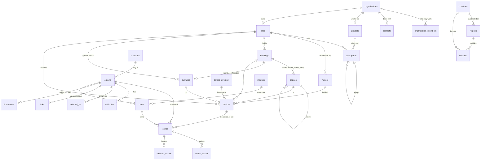

# The core model

The core names seven objects, in the order a page walks them:
organisation → project → participant → site (buildings, spaces, surfaces)
→ meter → device → series ([0006](decisions/0006-named-objects.md)); and the
engine that attaches everything else to any of them. A trade that needs
more adds a module with its own schema, starting from one of these objects
([0042](decisions/0042-a-module-starts-from-an-object-of-the-core.md)); a
country adds a pack.



`objects` is the registry: one row per organisation, project, participant,
site, building, space, surface, meter or device (and per object a module
declares: a PV array, a task), with its kind, its organisation and its
scenario. The named tables keep it up to date by trigger; `declare_object()`
registers a module's table as a kind, with the columns that lead to its
parents. Attachments point to the registry; pages read the named tables.

## Who

- **organisations** — the tenant, with its members (`owner`, `editor`,
  `viewer`; `create_organisation`, `add_member`, `set_member_role`,
  `remove_member`, never without an owner). An organisation is an object
  ([0023](decisions/0023-an-organisation-is-an-object.md)): its identifiers,
  documents and its own defaults attach to it as to any other.
- **contacts** — a person or a company the organisation deals with: a name
  and a kind. How to reach and invoice them is the accounting side's (the
  `accounting` module, [0010](decisions/0010-ekwo-link.md)). Nexgen OS keeps
  no invoice and no ledger: a settlement line goes to [Ekwo OS](https://github.com/Ekwo-ai/ekwo-os)
  ([why](../README.md#invoicing-and-ekwo-os)), which installs beside it on one
  database ([with Ekwo OS](with-ekwo-os.md)).

## On what

- **projects** — what a person works on: an energy community, a
  portfolio, a study, a construction site, a district plan (`kind`), with
  the country whose rules apply, a perimeter on the map, a status from
  `simulation` to `archived` and its dates. The allocation key of a
  community, the installed power of a portfolio are attributes; the tasks of
  its works are the `tasks` module's.
- **participants** — a site's role in a project, `producer`, `consumer` or
  `prosumer`, with the contact who answers for it (the owner, the tenant,
  the company), its status and the period it takes part. It groups what is
  behind the meters of its site; a participant without a site groups others
  (two tenants of one landlord, a campus), of the same project. A site takes
  part in a project once at a time and may take part in several projects.
  `join_project`, `leave_project`; `participant_meters(participant)` lists
  the connection points it is behind, groups included.


- **sites** — the place a person owns, rents or operates, in the one
  standard shape of a place ([0025](decisions/0025-a-place-has-one-shape.md)),
  with a time zone and a profile (what it is used for). `create_site()`
  takes the shape below and defaults the time zone to the region's, else the
  country's first, from the pack; `locate_site()` places it again from a
  geocoder's answer; `place_of(site)` gives it back. Everything on a site
  inherits its country: `country_of()`, `site_of()`.
- **buildings** — footprint, elevation, height, profile, status, the source
  it was described from and, in `metadata`, what that source said beyond the
  columns. `building_volume()` extrudes the footprint. Its year, material
  and floor counts are attributes.
- **spaces** — the inside of a building, one tree
  ([0026](decisions/0026-a-device-is-placed-on-a-surface-or-in-a-space.md)):
  `floor` (with its `level`), `room`, `zone`, `unit`, each with its
  building, its parent space, elevation, height and geometry, the source it
  was described from and its `metadata` (`add_space`).
- **surfaces** — a roof face, a facade, a ground area or a carport, on a
  building or straight on a site (a ground-mounted plant, a field or a car
  park has surfaces and no building), with azimuth (degrees clockwise from true north) and
  tilt; `add_surface` reads them from a 3D polygon when none is given.

### The shape of a place

Every geocoder, importer, connector and the command line produce this one
JSON object, and `sites` stores it in columns of the same names. A place
travels between systems as a GeoJSON feature whose properties are these keys
(`packages/formats/geojson`).

```json
{
  "street": "12 School Street",
  "address_extra": "Building B, box 3",
  "postal_code": "1000",
  "city": "Port Town",
  "region": "XX-AB",
  "country": "XX",
  "geometry": { "type": "Point", "coordinates": [4.4702, 50.6802, 112] },
  "location_precision": "rooftop",
  "location_source_code": "nominatim",
  "identifiers": [{ "scheme": "osm", "value": "way/123" }]
}
```

`country` is ISO 3166-1 alpha-2 and the only key required; `region` is ISO
3166-2 and must be one the country's pack lists, when it lists any; the
geometry is WGS 84 with its height; `location_precision` is `rooftop`,
`parcel`, `street`, `postal_code`, `city` or `region`; `location_source_code`
names a row of `sources`; `identifiers` (a municipality code, a cadastral
parcel, an address register id) become `external_ids` of the site. Any other
key is refused (`place_key_unknown`).

## Connected by

- **meters** — the connection point of a site to a network (electricity,
  gas, heat, water), the frontier between the grid and the place (IEC CIM
  *UsagePoint*): the identifier its operator knows and its scheme (a GS1
  GSRN, or a scheme a pack publishes, checked by `identifier_valid`), what
  it can do (`offtake`, `injection`, `both`) and the period that identifier
  names it. `declare_meter` refuses `invalid_identifier` and
  `meter_already_open`; `close_meter` ends the period when the register
  retires the number. Its subscribed power is an attribute. The physical
  meter is a device of type `meter` and can be swapped; who operates the
  point and how it is connected are the `grid` module's (`grid.connections`).

## What

- **devices** — anything installed, including the instruments that measure:
  a PV system, a battery, a heat pump, a meter, a thermometer
  ([0022](decisions/0022-the-instrument-is-a-device-the-point-is-the-series.md)).
  Type (from `device_types`), site, and where on it — building, space,
  surface — checked together by `devices_check`; catalogue product,
  manufacturer, model, rated power, unit count, status, installation and
  removal dates, and the meter of its site it is behind (`meter_id`, none
  for an instrument that measures nothing on the grid side). `install_device`
  (with the nameplate and `metadata` of the file it was read from, when no
  product is named, and its meter), `move_device` (the place it leaves stays
  as a `placed_in` link), `connect_device` (the meter it leaves stays as a
  `behind_meter` link: the column is today, the links are the history),
  `retire_device`, `replace_device` (a `replaces` link, same place, same
  meter). Anything else about where it belongs — the zone it serves — is a
  link. A module derives the types it owns:
  `call derive_devices('solar.pv_systems', 'solar')` makes a table with the
  same id, refused for any other type.
- **device_directory** — products: manufacturer, model, unit power,
  capacity, price. Shared rows (`organisation_id` null) come from modules and
  packs.

## Over time

- **series** — one quantity of one object over time: the object it
  describes, the device that measures it or is set through it when there is
  one, its kind (`measured`, `simulated`, `forecast`, `setpoint`,
  `command`), what one value means (`interval`, `instant`, `cumulative`),
  its step, its source and `external_ref` (how a connector finds the point:
  a Home Assistant entity, a Modbus register, an MQTT topic), the run that
  computed it (`run_id`), and in `metadata` only what the source adds. One
  series per identity — object, quantity, kind, source, scenario, name,
  run — found or created by `series_ensure()`, which refuses another value
  kind or step by name. A simulated series names its run or its source
  (`series_run_required`).
- **series_values** — the values, in the unit of the quantity, dated at the
  start of their interval in UTC, with a quality code of
  `series_quality_codes` (0 measured, 1 estimated, 2 substituted,
  3 missing; 100 and up for a pack's mapping of a data hub's flags).
  Partitioned by week on `at` (`series_values_partition()` in UTC, or
  pg_partman). **forecast_values** keeps every issue of a `forecast`
  series with the time it was issued.
- **units** — QUDT codes and symbols, each with its quantity kind and the
  factor and offset to the SI unit of that kind. `convert_unit(value, from,
  to)` converts between two units of a kind (`unit_unknown`,
  `unit_incompatible`); format libraries look units up here instead of
  keeping factors of their own
  ([0030](decisions/0030-a-value-is-stored-in-the-unit-of-its-quantity.md)).

**One way to write**
([0031](decisions/0031-one-way-to-write-a-series-one-way-to-read-it.md)).
`store(series, at[], value[], quality[]?, unit?, issued_at?, identity?)`
is the only write the API roles are granted: the series by its id or by its
identity (created through `series_ensure()`), the values converted from
`unit` to the quantity's (`series_unit_mismatch`), a null stored missing,
instants on the series' step (`series_step_mismatch`), a forecast with its
issue time (`issued_at_required`), the series of a finished run never
written again (`run_is_final`). A value equal to the one stored is left as
it is, so a second import of the same file changes nothing. Every write
marks the hours it touched in **series_dirty** and keeps **series_latest**,
the last value of each series. The connectors (`storeSeries()`), the
format libraries, the modules, `record_run()` and the Python client all
call it.

**Aggregates are derived.** **series_rollups** holds hourly (UTC) and daily
(the site's time zone) aggregates: count, sum, minimum, maximum, last value,
and for a register its consumption. `series_rollup()` drains the dirty
hours and computes them again from the values; pg_cron runs it every minute
where it is installed, elsewhere whoever maintains the installation calls
it. A rollup in a dirty hour is never read.

**One family of reads**, each `security definer` with one access check per
series (a member of its organisation, or a role that bypasses row level
security; a role without a signed-in user reads nothing):

| Function | Answers |
|---|---|
| `resample(series, from, to, step, time_zone?, issued_before?)` | the amount of each bucket: the quantity's sum, mean or last; for a cumulative register the consumption of the bucket, resets handled; with `samples`, `expected` and the worst `quality`. Durations bin from local midnight (half-hour time zones fall on local hours); a number of days or months cuts in the site's time zone (`time_zone_required` without one), `step_unsupported` for a step that mixes them. Reads the rollups when they cover the buckets and are fresh |
| `nexgen.window(series, from, to, limit?)` | the stored values in time order: how an index is read (`window` is a reserved word: call it qualified) |
| `latest(series[])` | the last value that is not missing, one row per series |
| `fill(series, from, to, step, method, time_zone?)` | every bucket, empty ones filled on the fly (`none`, `zero`, `previous`, `linear`) and flagged estimated; nothing is written. A substitute that must be stored is a run of a module (a validation module), with its method |
| `coverage(series, from, to)` | the gaps of a regular series: bounds and count of the values it lacks |
| `forecast_at(series, from, to, as_of?, horizon?)` | a forecast as known at `as_of`, or issued `horizon` before each instant, or its latest issue |
| `export_rows(series[], from, to)` | series, instant, value, quality, sorted: the rows `exportSeriesParquet()` of `@nexgen-os/core` reads and `packages/formats/parquet` writes as a file |

The same calls are typed for TypeScript in `packages/core/src/series.ts` and for
Python in `packages/python` (rows by default; Arrow, pandas and Polars as
optional extras).

- **runs** — a computation of a module on an object: inputs, engine
  version, results ([0004](decisions/0004-deterministic-runs.md)).
  `record_run()` (or `start_run()` then `finish_run()`) writes it with the
  series it owns (`series.run_id`): the same identity gives the same run, a
  finished run and its series never change, and two runs never share a
  series. `discard_superseded_series()` deletes the series of runs later
  runs replaced; the runs stay.
- **scenarios** — `scenario_id is null` is the world as it is. A scenario
  holds what a variant adds: objects, attributes that override reality,
  series. A scenario may build on another one (`create_scenario`).

## Attached to any object

- **attributes** — one row per property and validity period, typed by
  `property_defs` (datatype, quantity hence unit, range, allowed values,
  kinds it applies to), with its source. A column holds only what every row
  has and every query filters on
  ([0019](decisions/0019-a-column-only-for-what-every-row-has.md)); the rest
  is an attribute. `set_attribute()` closes the period holding and opens the
  next; `attributes_of(object, at, scenario)` reads them.
- **external_ids** — unique per scheme in an organisation, checked against
  the scheme's pattern, with validity (`add_identifier`).
- **links** — typed and dated (`serves`, `shades`, `occupies`, `owns`,
  `placed_in`…); the link type may require kinds on either side
  (`link_objects`, `end_link`). Splits, merges and replacements are links
  too: `split_into`, `merged_into`, `replaces` (`split_object`,
  `merge_objects`). Identifiers never encode anything and are never reused.
- **documents** — permit, datasheet, report, photo, video, plan: a URI, a
  media type, a source, a capture date (`attach_document`). Heavy files stay
  in object storage; georeferenced 3D models are the `3d` module's.
- **tags** — marker tags from `tags`, checked on write.

## Countries and defaults

- **countries** — what a pack says a country is: currency, languages, time
  zones, the level its regions are listed at, postal code pattern,
  municipality identifier scheme, and which version of the pack the
  installation holds, with its checksum and certification.
- **regions** — its ISO 3166-2 subdivisions at that level, with their
  parent and time zone.
- **defaults** — the values a country or one of its regions decides, by
  property, each with its period, source and reference; never edited, a new
  value is a new row and a `valid_to` on the old one.
- **`parameter_of(object, property, at, scenario)`** — the one resolution of
  a parameter ([0021](decisions/0021-one-cascade-of-defaults.md)): the
  object's own attribute, its parents' nearest first, its organisation's
  attribute, its region's default, its country's — `{value, level,
  source_code, reference, valid_from}`. There is no global level: nothing
  found is `parameter_missing` naming the property and the level reached; a
  country that decides no single value answers `parameter_not_decided` with
  its reference. A run records what it read.

All three are written by the packs (`nexgen-os pack build`) and read by
everyone signed in.

## Vocabularies

`device_types` (with the module that derives each), `profiles` (uses of a
building or a site), `link_types`, `quantities` (one unit each, QUDT),
`units` (QUDT codes and symbols, with the factor and offset of each),
`property_defs` (bSDD / IFC, including the values packs publish),
`tags` (Haystack), `id_schemes` and `sources` (the external APIs, datasets,
registers and published texts: base URL, authentication type, licence,
attribution, countries, regions, retention). An organisation's use of a
source is a `connections` row naming its secret; the code that reads it is
a connector under `connectors/` ([0011](decisions/0011-external-data.md)).
Read by everyone signed in, written by migrations, seeds, modules and packs.

## What the modules add

| Module | Schema | Holds |
|---|---|---|
| `grid` | `grid` | the grid side of a meter of the core: `operators` (who runs the grid, written by packs) and `connections`, one row per meter with the meter's id, its operator and its voltage level (`connect_to_operator`) |
| `community` | `community` | energy sharing among the participants of a project of the core: the allocation key and what it reads of each participant, as attributes, and the shares an engine computes, as runs |
| `accounting` | `accounting` | the accounting bridge: the Ekwo company of an organisation, how a contact is reached and which Ekwo contact it is; where Nexgen OS stops and Ekwo OS starts is in the [README](../README.md#invoicing-and-ekwo-os) |
| `solar`, `weather`, `tasks` | their own | PV systems and yields, weather models and points, tasks as data |

## Geometry

Stored in EPSG:4326, always in three dimensions, Z in metres above sea
level. Any CRS is accepted on the way in, through GeoJSON `crs` or an SRID.
`to_core_geometry()` transforms, validates and lifts the shape to 3D;
`metric_srid()` gives the UTM zone of any shape, so `area_m2()` and
distances are in metres anywhere, without a national grid.

## Files in and out

A file reaches the model in two steps
([0035](decisions/0035-a-format-library-touches-no-database.md)): a
format library of `packages/formats/` (MIT, no dependency on Nexgen OS)
reads it into plain shapes, and an importer of `@nexgen-os/core` — or of
the module that owns the rows — writes those shapes through the gestures
above, with the source the caller names. An exporter reads the rows back
into the same shapes, and the library writes the file.

| File | Library | Importer, exporter |
|---|---|---|
| Home Assistant snapshot | `homeassistant`: `readHomeAssistant`, `writeHomeAssistant` | `importHomeAssistant`, `exportHomeAssistant` (core) |
| CityJSON 2.0 | `cityjson`: `readCityJson`, `writeCityJson` | `importCityJson`, `exportCityJson` (core) |
| IFC4, IFC2x3 | `ifc`: `readIfc` | `importIfc` (core) |
| GeoJSON | `geojson`: `readGeoJson`, `writeGeoJson` | `exportGeoJson` (core) |
| EPW, TMY3 | `weather-files`: `readEpw`, `readTmy3`, `writeEpw` | `importWeatherFile`, `exportWeatherYear` (core) |
| Parquet | `parquet`: `writeSeriesParquet` | `exportSeriesParquet` (core) |
| PVsyst PAN, OND | `panond`: `readPan`, `readOnd` | `importProduct` (`modules/solar/src/products.ts`) |

## Security

Every table of an organisation's data carries `organisation_id`, copied by
trigger from the object an attachment points to. Members read; owners and
editors write. Objects named by a foreign key are checked to be in the same
organisation and a compatible scenario (`parent_check`). Every gesture is a
`security invoker` function: it acts with the rights of the person calling
it and refuses by name ([0038](decisions/0038-everything-raises-by-name.md)).
The series are the one exception, by design: `store()` and the reads are
`security definer`, check the caller's organisation once per series, and
the API roles hold no insert, update or delete on the value tables, so that
the write path is the only one.
Vocabularies, countries, regions and defaults are read by everyone signed in
and written only by the installation.
