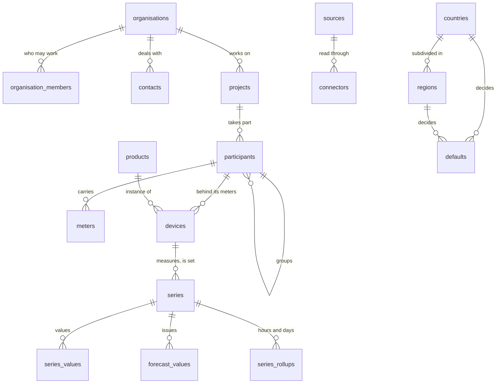
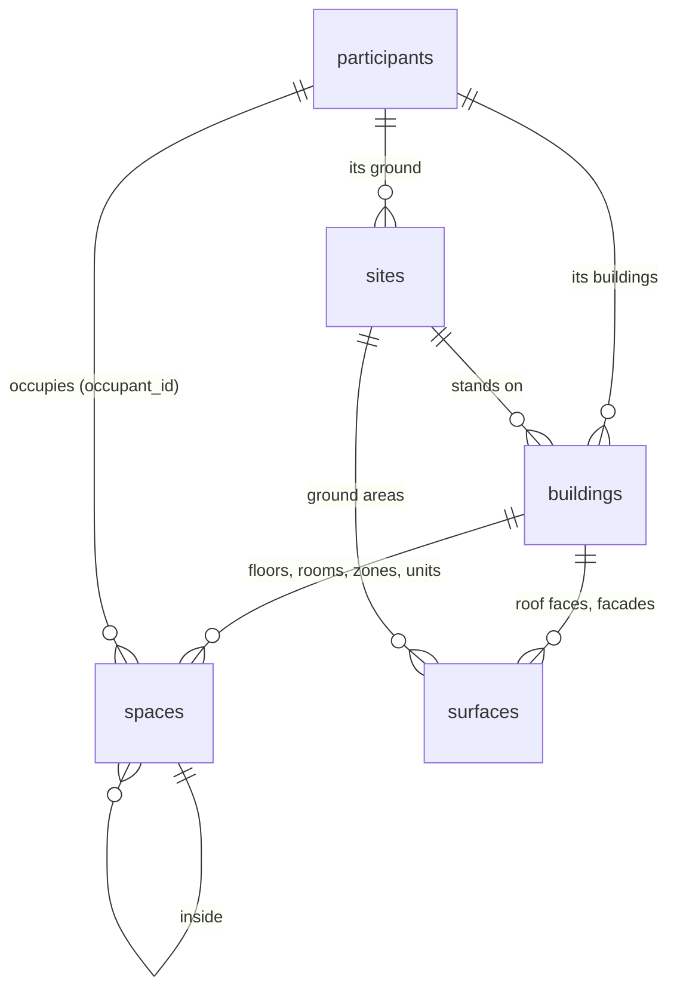

# The core model

The core names six objects, in the order a page walks them:
organisation → project → participant → meter and device → series
([0006](decisions/0006-the-core-names-six-objects.md)); and what attaches to them, with
the vocabularies, the countries and the gestures that keep them. The core
is twenty-seven tables and one view. The participant is the node
([0043](decisions/0043-the-participant-is-the-node.md)): it carries the
place, geolocated but not described, the meters and the devices behind
them, and every module starts from it. Its ground, its buildings, floors,
rooms and roof faces are the `building` module's
([0008](decisions/0008-the-building-module-describes-what-is-built.md)); a device belongs to its
participant ([0026](decisions/0026-a-device-belongs-to-its-participant.md)). A trade that
needs more adds a module with its own schema, starting from one of these
objects ([0042](decisions/0042-a-module-starts-from-an-object-of-the-core.md));
a country adds a pack.



The hierarchy is the foreign keys, and nothing mirrors it
([0001](decisions/0001-the-hierarchy-is-the-foreign-keys.md)). An attachment — an
attribute, an identifier, a document, a series — names its object by its
kind and its id, the kind one of the six objects: `organisation`,
`project`, `participant`, `meter`, `device`, `series`, checked by a plain
`check (object_kind in (…))` as Ekwo OS attaches its files.
`object_organisation(kind, id)` reads an object's
organisation in the table of its kind; `drop_attachments()`, after delete
on each of those tables, takes away what was attached to the row.
`participant_of(kind, id)` and `parameter_of(kind, id, …)` follow the
core's foreign keys. A relation a module needs is a column of that
module's table pointing to an object of the core. Pages read the named
tables.

The `building` module, beside the core:



## Who

- **organisations** — the tenant, with its members (`owner`, `editor`,
  `viewer`; `create_organisation`, `add_member`, `set_member_role`,
  `remove_member`, never without an owner). An organisation is an object
  ([0023](decisions/0023-an-organisation-is-an-object.md)): its identifiers,
  documents and its own defaults attach to it as to any other.
- **contacts** — a person or a company the organisation deals with: a name
  and a kind. How to reach and invoice them is the invoicing side's (the
  `billing` module, [0010](decisions/0010-the-participant-is-billed-ekwo-os-keeps-the-invoice.md)). Nexgen OS keeps
  no invoice and no ledger: a settlement line goes to [Ekwo OS](https://github.com/Ekwo-ai/ekwo-os)
  ([why](../README.md#invoicing-and-ekwo-os)), which installs beside it on one
  database ([with Ekwo OS](with-ekwo-os.md)).

## On what

- **projects** — what a person works on: an energy community, a set of
  buildings, a study, a construction site, a district plan (`kind`), with
  the country whose rules apply, a perimeter on the map, a status from
  `simulation` to `archived` and its dates. The allocation key of a
  community, the installed power of a set of buildings are attributes; the tasks of
  its works are the `planning` module's.
- **participants** — the node of a project
  ([0043](decisions/0043-the-participant-is-the-node.md)): an actor — a
  household, a company, a tenant, a PV plant — `producer`, `consumer` or
  `prosumer`, with the contact who answers for it (the owner, the tenant,
  the company), its status and the period it takes part. It carries the
  place (below), its meters (`meters.participant_id`) and the devices
  behind them (`devices.participant_id`): seen from the grid, everything
  *behind the meter* is the participant's, and everything in front of it —
  the network, the market, the community's allocation — is the project's or
  the grid module's. Two flats of one building are two participants, each
  with its address line and its meter; the floor or the unit each occupies
  is the `occupant_id` of a space of the `building` module. A participant without
  a place groups others (two tenants of one landlord, a campus), of the
  same project, and carries no meter and no device
  (`participant_group_carries`). A participant is in one project.
  `join_project`, `locate_participant`, `leave_project`;
  `participant_meters(participant)` lists the connection points it carries,
  groups included.

## Where

The place is the participant's, in the one standard shape of a place
([0025](decisions/0025-a-place-has-one-shape.md)): its address, its point
or outline on the map and its time zone.
`join_project()` takes the shape below and defaults the time zone to the
region's, else the country's first, from the pack; `locate_participant()`
places it again from a geocoder's answer; `place_of(participant)` gives it
back. Everything of a participant inherits its country:
`country_of(kind, id)`, `participant_of(kind, id)`. The place is
geolocated, not described.

What the place physically is belongs to the `building` module (`building`,
[0008](decisions/0008-the-building-module-describes-what-is-built.md)), when it is installed:

- **building.sites** — the ground of a participant: a parcel or a plot
  with its outline, the area a register gives, its use, its source
  (`building.add_site`). A ground-mounted plant, a field or a car park is a
  ground with surfaces and no building.
- **building.buildings** — a building of a participant, on its ground when
  it is described: footprint, elevation, height, use (`building.profiles`),
  status, year of construction, floors above and below ground, gross floor
  area, energy label, the source it was described from, the identifier
  that source gives it (`global_id`) and, in `metadata`, what that source
  said beyond the columns. `building.building_volume()` extrudes the
  footprint.
- **building.spaces** — the inside of a building, one tree
  ([0026](decisions/0026-a-device-belongs-to-its-participant.md)):
  `floor` (with its `level`), `room`, `zone`, `unit`, each with its
  building, its parent space, elevation, height, geometry and floor area,
  the source it was described from, its identifier and its `metadata`
  (`building.add_space`). The participant that occupies a floor or a unit
  is its `occupant_id`.
- **building.surfaces** — a roof face, a facade, a ground area or a carport,
  on a building or straight on the ground, with azimuth (degrees clockwise
  from true north) and tilt, its measured area, material, U-value and
  whether it faces outside; `building.add_surface` reads the orientation
  from a 3D polygon when none is given.

### The shape of a place

Every geocoder, importer, connector and the command line produce this one
JSON object, and `participants` stores it in columns of the same names. A
place travels between systems as a GeoJSON feature whose properties are
these keys (`packages/formats/geojson`).

```json
{
  "street": "12 School Street",
  "address_extra": "Building B, box 3",
  "postal_code": "1000",
  "city": "Port Town",
  "region": "XX-AB",
  "country": "XX",
  "geometry": { "type": "Point", "coordinates": [4.4702, 50.6802, 112] },
  "location_precision": "rooftop",
  "location_source_code": "nominatim",
  "identifiers": [{ "scheme": "osm", "value": "way/123" }]
}
```

`country` is ISO 3166-1 alpha-2 and the only key required; `region` is ISO
3166-2 and must be one the country's pack lists, when it lists any; the
geometry is WGS 84 with its height; `location_precision` is `rooftop`,
`parcel`, `street`, `postal_code`, `city` or `region`; `location_source_code`
names a row of `sources`; `identifiers` (a municipality code, a cadastral
parcel, an address register id) become `external_ids` of the participant.
Any other key is refused (`place_key_unknown`).

## Connected by

- **meters** — the connection point of a participant to a network
  (electricity, gas, heat, water), the frontier between the grid and the
  place (IEC CIM *UsagePoint*): the identifier its operator knows and its
  scheme (a GS1 GSRN, or a scheme a pack publishes, checked by
  `identifier_valid`), what it can do (`offtake`, `injection`, `both`), the
  period that identifier names it, and the participant that carries it
  (`participant_id`); one per participant, exceptionally several.
  `declare_meter` refuses `invalid_identifier`, `meter_already_open` and a
  group (`participant_group_carries`); `assign_meter` gives it to another
  participant (a new tenant); `close_meter` ends the period when the register
  retires the number. Its subscribed power is an attribute. The physical
  meter is a device of type `meter` and can be swapped; who operates the
  point and how it is connected are the `grid` module's (`grid.meters`).

## What

- **devices** — anything a participant has behind its meters, including
  the instruments that measure: a PV system, a battery, a charger, a heat
  pump, a meter, a thermometer, a weather station
  ([0022](decisions/0022-the-instrument-is-a-device-the-point-is-the-series.md)).
  Its participant, type (from `device_types`), catalogue product,
  manufacturer, model, rated power, unit count, status, installation and
  removal dates. One device has as many series as it measures. Nothing
  places it in a building
  ([0026](decisions/0026-a-device-belongs-to-its-participant.md)); what a file
  said about it is an attribute the module that read the file declares
  (`file_record` of `building`). `install_device` (with the nameplate of
  the file it was read from, when no product is named), `retire_device`,
  `replace_device` (a new device of the same participant, installed the day
  the old one is retired). A module derives the types
  it owns: `call derive_devices('solar.devices', 'solar')` makes a table
  with the same id, refused for any other type.
- **products** — the catalogue: manufacturer, model, unit power,
  capacity, price. Shared rows (`organisation_id` null) come from modules and
  packs.

## Over time

- **series** — one quantity of one object over time: the object it
  describes, the device that measures it or is set through it when there is
  one, its kind (`measured`, `simulated`, `forecast`, `setpoint`,
  `command`), what one value means (`interval`, `instant`, `cumulative`),
  its step, its source and `external_ref` (how a connector finds the point:
  a Home Assistant entity, a Modbus register, an MQTT topic), a free note of
  where its values come from (`source`: a figure of a module names itself
  there, `<module>.<table>:<id>`), and in `metadata` only what the source
  adds. One series per identity — object, quantity, kind, source code,
  source, name — found or created by `series_ensure()`, which refuses
  another value kind or step by name. A simulated series names the figure that wrote it
  or its source (`series_calculation_required`).
- **series_values** — the values, in the unit of the quantity, dated at the
  start of their interval in UTC, with a quality code checked by the column
  (0 measured, 1 estimated, 2 substituted, 3 missing; 100 and up for a
  pack's mapping of a data hub's flags).
  Partitioned by week on `at` (`series_values_partition()` in UTC, or
  pg_partman). **forecast_values** keeps every issue of a `forecast`
  series with the time it was issued.
- **units** — QUDT codes and symbols, each with its quantity kind and the
  factor and offset to the SI unit of that kind. `convert_unit(value, from,
  to)` converts between two units of a kind (`unit_unknown`,
  `unit_incompatible`); format libraries look units up here instead of
  keeping factors of their own
  ([0030](decisions/0030-a-value-is-stored-in-the-unit-of-its-quantity.md)).

**One way to write**
([0031](decisions/0031-one-way-to-write-a-series-one-way-to-read-it.md)).
`store(series, at[], value[], quality[]?, unit?, issued_at?, identity?)`
is the only write the API roles are granted: the series by its id or by its
identity (created through `series_ensure()`), the values converted from
`unit` to the quantity's (`series_unit_mismatch`), a null stored missing,
instants on the series' step (`series_step_mismatch`), a forecast with its
issue time (`issued_at_required`). A value equal to the one stored is left as
it is, so a second import of the same file changes nothing. Every write
computes again the rollups of the hours it touched; **series_latest** is a
view, the last value of each series that is not missing. The connectors (`storeSeries()`), the
format libraries, the modules and the Python client all call it.

**Aggregates are derived.** **series_rollups** holds hourly (UTC) and daily
(the participant's time zone) aggregates: count, sum, minimum, maximum, last value,
and for a register its consumption, computed again from the values by
every statement that writes or deletes values (`series_rollup_hours()`):
there is no queue and nothing to drain.

**One family of reads**, each `security definer` with one access check per
series (a member of its organisation, or a role that bypasses row level
security; a role without a signed-in user reads nothing):

| Function | Answers |
|---|---|
| `resample(series, from, to, step, time_zone?, issued_before?)` | the amount of each bucket: the quantity's sum, mean or last; for a cumulative register the consumption of the bucket, resets handled; with `samples`, `expected` and the worst `quality`. Durations bin from local midnight (half-hour time zones fall on local hours); a number of days or months cuts in the participant's time zone (`time_zone_required` without one), `step_unsupported` for a step that mixes them. Reads the rollups when they cover the buckets |
| `nexgen.window(series, from, to, limit?)` | the stored values in time order: how an index is read (`window` is a reserved word: call it qualified) |
| `latest(series[])` | the last value that is not missing, one row per series |
| `fill(series, from, to, step, method, time_zone?)` | every bucket, empty ones filled on the fly (`none`, `zero`, `previous`, `linear`) and flagged estimated; nothing is written. A substitute that must be stored is a figure of a module (a validation module), with its method |
| `coverage(series, from, to)` | the gaps of a regular series: bounds and count of the values it lacks |
| `forecast_at(series, from, to, as_of?, horizon?)` | a forecast as known at `as_of`, or issued `horizon` before each instant, or its latest issue |
| `export_rows(series[], from, to)` | series, instant, value, quality, sorted: the rows `exportSeriesParquet()` of `@nexgen-os/core` reads and `packages/formats/parquet` writes as a file |

The same calls are typed for TypeScript in `packages/core/src/series.ts` and for
Python in `packages/python` (rows by default; Arrow, pandas and Polars as
optional extras).

- **estimates and settlements** — a figure is a row of the module that
  computes it, in a plain table named after what it gives
  (`solar.estimates`, `consumption.estimates`, `community.settlements`), its
  subject a foreign key to an object of the core: `provenance` (the program
  and the version that computed it), `inputs`, `results`, `created_at`,
  `updated_at` ([0004](decisions/0004-a-figure-says-where-it-comes-from.md)).
  Each module writes its rows with its own function, with the series it
  computed, whose `source` names the row; a new computation adds a row or
  replaces the one it names, and two figures never share a series. The core
  keeps no gesture of its own for them.
- **design variants** are the `solar` module's (`solar.variants`): the
  arrays and horizons of a variant of a participant's PV. The core holds
  the world as it is; a planned device has the status `planned`.

## Attached to an object of the core

Every attachment names its object by its kind and its id (`object_kind`,
`object_id`), the kind one of the six objects, and every gesture takes
both: `set_attribute('participant', id, …)`. The organisation it is
stored in is the object's; an object that is not found, of a seventh kind,
or of another organisation is refused by name (`object_not_found`,
`kind_unknown`, `object_in_other_organisation`). Deleting an object
deletes what was attached to it. A module's table about an object of the
core (a task, a horizon, activity hours) names it the same way, with the
same check.

- **attributes** — one row per property and validity period, typed by
  `attribute_types` (datatype, quantity hence unit, range, allowed values,
  kinds it applies to), with its source. A column holds only what every row
  has and every query filters on
  ([0019](decisions/0019-a-column-only-for-what-every-row-has.md)); the rest
  is an attribute. `set_attribute(kind, id, …)` closes the period holding
  and opens the next; `attributes_of(object, at)` reads them.
- **external_ids** — unique per scheme in an organisation, checked against
  the scheme's pattern, with validity (`add_identifier`).
- **documents** — permit, datasheet, report, photo, video, plan: a URI, a
  media type, a source, a capture date (`attach_document`). Heavy files stay
  in object storage; georeferenced 3D models are the `building` module's.

## Countries and defaults

- **countries** — what a pack says a country is: currency, languages, time
  zones, the level its regions are listed at, postal code pattern,
  municipality identifier scheme, and which version of the pack the
  installation holds, with its checksum.
- **regions** — its ISO 3166-2 subdivisions at that level, with their
  parent and time zone.
- **defaults** — the values a country or one of its regions decides, by
  property, each with its period, source and reference; never edited, a new
  value is a new row and a `valid_to` on the old one.
- **`parameter_of(kind, object, property, at)`** — the one resolution of
  a parameter ([0021](decisions/0021-one-cascade-of-defaults.md)): the
  object's own attribute, its parents' nearest first along the core's
  foreign keys (`parents_of()`: a device's participant, its group and its
  project), its organisation's attribute, then the default of the region of
  the participant's place, of the regions it is part of (`regions.parent`,
  nearest first) and of its country — `{value, level,
  source_code, reference, valid_from}`. There is no global level: nothing
  found is `parameter_missing` naming the property and the level reached; a
  country that decides no single value answers `parameter_not_decided` with
  its reference. A figure records what it read.

All three are written by the packs (`nexgen-os pack build`) and read by
everyone signed in.

## Vocabularies

`device_types` (with the module that derives each), `quantities` (one
unit each, QUDT), `units` (QUDT codes and symbols, with the factor and
offset of each), `attribute_types` (what an attribute may hold: the values
`parameter_of()` resolves, those the packs publish and those a module
declares), `id_schemes` and `sources` (the external APIs, datasets,
registers and published texts: base URL, authentication type, licence,
attribution, countries, regions, retention). An organisation's use of a
source is a `connectors` row naming its secret: the connector, the code
under `packages/connectors/` that reads it, configured for that
organisation ([0011](decisions/0011-external-data.md)).
Read by everyone signed in, written by migrations, seeds, modules and packs.

## What the modules add

| Module | Schema | Holds |
|---|---|---|
| `grid` | `grid` | the grid side of a meter of the core: `operators` (who runs the grid, written by packs) and `meters`, the grid side of a meter of the core, one row per meter with the meter's id, its operator and its voltage level (`connect_to_operator`) |
| `community` | `community` | energy sharing among the participants of a project of the core: the allocation key and what it reads of each participant, as attributes, and the shares an engine computes, as its `settlements` |
| `building` | `building` | the physical description of the place of a participant: `profiles` (the uses of a building or a place), `sites` (its ground), `buildings`, `spaces` (floors, rooms, zones, units, one tree, with the participant that occupies one) and `surfaces` (roof faces, facades, ground areas), each described in its columns, the importers of CityJSON, IFC and Home Assistant homes; it places no device |
| `billing` | `billing` | the billing bridge: the Ekwo company of an organisation, how a contact is reached and which Ekwo contact it is, the Ekwo invoices issued for or to a participant; where Nexgen OS stops and Ekwo OS starts is in the [README](../README.md#invoicing-and-ekwo-os) |
| `solar` | `solar` | PV systems and arrays, horizons, yield profiles, design variants (`variants`) and the `estimates` of yields, performance and exceedance |
| `consumption` | `consumption` | load profiles, activity hours and the `estimates` that reconstructed a curve |
| `weather`, `planning` | their own | weather models, points and which participants read them; tasks as data |

## Geometry

Stored in EPSG:4326, always in three dimensions, Z in metres above sea
level. Any CRS is accepted on the way in, through GeoJSON `crs` or an SRID.
`to_core_geometry()` transforms, validates and lifts the shape to 3D;
`metric_srid()` gives the UTM zone of any shape, so `area_m2()` and
distances are in metres anywhere, without a national grid.

## Files in and out

A file reaches the model in two steps
([0035](decisions/0035-a-format-library-touches-no-database.md)): a
format library of `packages/formats/` (MIT, no dependency on Nexgen OS)
reads it into plain shapes, and an importer of `@nexgen-os/core` — or of
the module that owns the rows — writes those shapes through the gestures
above, with the source the caller names. An exporter reads the rows back
into the same shapes, and the library writes the file.

| File | Library | Importer, exporter |
|---|---|---|
| Home Assistant snapshot | `homeassistant`: `readHomeAssistant`, `writeHomeAssistant` | `importHomeAssistant`, `exportHomeAssistant` (`modules/building/src`) |
| CityJSON 2.0 | `cityjson`: `readCityJson`, `writeCityJson` | `importCityJson`, `exportCityJson` (`modules/building/src`) |
| IFC4, IFC2x3 | `ifc`: `readIfc` | `importIfc` (`modules/building/src`) |
| GeoJSON | `geojson`: `readGeoJson`, `writeGeoJson` | `exportGeoJson` (core; the buildings and surfaces when `building` is installed) |
| EPW, TMY3 | `weather-files`: `readEpw`, `readTmy3`, `writeEpw` | `importWeatherFile`, `exportWeatherYear` (core) |
| Parquet | `parquet`: `writeSeriesParquet` | `exportSeriesParquet` (core) |
| PVsyst PAN, OND | `panond`: `readPan`, `readOnd` | `importProduct` (`modules/solar/src/products.ts`) |

## Security

Every table of an organisation's data carries `organisation_id`, copied by
trigger from the object an attachment names. Members read; owners and
editors write. Objects named by a foreign key are checked to be in the same
organisation (`parent_check`). Every gesture is a
`security invoker` function: it acts with the rights of the person calling
it and refuses by name ([0038](decisions/0038-everything-raises-by-name.md)).
The series are the one exception, by design: `store()` and the reads are
`security definer`, check the caller's organisation once per series, and
the API roles hold no insert, update or delete on the value tables, so that
the write path is the only one.
Vocabularies, countries, regions and defaults are read by everyone signed in
and written only by the installation.
