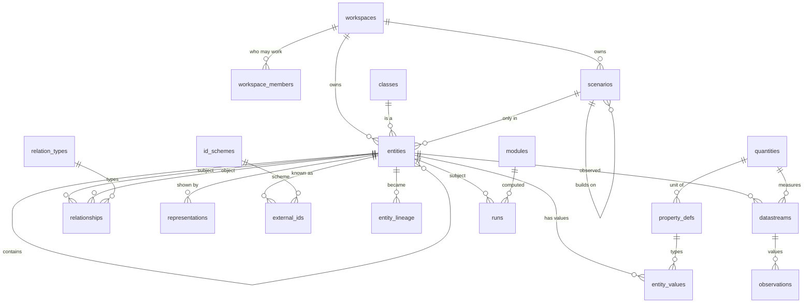

# The core model

## Entities

One table holds everything that can be described. The six root classes:

| Root | Examples | Brick | IFC |
|---|---|---|---|
| `location` | district, site, parcel, building, building part, storey, space, zone, outdoor area, grid connection point, infrastructure | Location | IfcSpatialElement |
| `element` | roof face, wall, slab, window or door, ground surface, vegetation | — | IfcElement |
| `equipment` | PV array, wind turbine, inverter, battery, EV charger, heat pump, boiler, air handling unit, meters | Equipment | IfcDistributionElement |
| `point` | sensor, setpoint, command | Point | IfcSensor / IfcController / IfcActuator |
| `agent` | organisation, person | — | IfcActor |
| `collection` | portfolio, energy community | Collection | IfcGroup |

Containment (`parent_id`) is a tree, checked against `classes.allowed_parents`
by class ancestry: a storey sits in a building, a room in a storey, an
inverter in a building or in another piece of equipment. Every other link is a
relationship.

Each entity has one main shape (`geometry`) plus `elevation_m`, `height_m`,
`azimuth_deg` and `tilt_deg`. That is enough for a level-of-detail 1 block
(`lod1_block()`) and for any planar computation on a roof face. Richer shapes
are representations.

## Attached to an entity

- **Values** (`entity_values`): one row per property and validity period.
  History is kept by closing a period and opening the next. Two values of the
  same property never overlap in the same scenario. Numbers are always in the
  unit of the property's quantity. Read them with
  `entity_properties(entity, at, scenario)`.
- **Relationships**: typed and dated. The relation type may require a class on
  either side (`occupies` goes from an agent to a location).
- **Representations**: several per entity, each with its kind, its level of
  detail (0, 1, 1.2, 1.3, 2, 2.2, 3), its geometry or the URI of a file, its
  source and capture date. Heavy files (point clouds, meshes, BIM models,
  videos, 3D tiles) stay in object storage. Only their registry row is in
  Postgres.
- **External identifiers**: unique per scheme in a workspace, checked against
  the scheme's pattern, with validity periods.
- **Lineage**: when an entity is split, merged or replaced, the old and new
  entities are linked. Identifiers never encode anything and are never reused.
- **Tags**: marker tags from `tags`, checked on use.

## Series

A **datastream** is one quantity observed on one entity. It says what kind it
is (`measured`, `simulated`, `forecast`, `setpoint`), what one value means
(`interval`, `instant`, `cumulative`) and at which step it comes, and it may
name the sensor or meter entity that produces it. **Observations** are its
timestamped values, with a quality flag. `series(datastream, from, to, step)`
resamples any series by the aggregation of its quantity. It is the one way
pages and modules read series.

## Scenarios

`scenario_id is null` is the world as it is. A scenario holds what a design
variant adds: entities, values that override reality, relationships, series.
A scenario may build on another one. `entity_properties` reads reality with
the scenario chain's overrides applied in order.

## Runs

A module hands its result back with
`record_run(module, engine_version, subject, scenario, inputs, results)`.
The run's identity is the sha256 of the module, the engine version, the
subject, the scenario and the canonical inputs. The same identity returns the
same run, and a finished run never changes.

## Geometry

Geometry is stored in EPSG:4326, always in three dimensions, with Z in metres
above sea level. Any CRS is accepted on the way in, through GeoJSON `crs` or
an SRID. `to_core_geometry()` transforms, validates and lifts the shape to 3D.
`metric_srid()` gives the UTM zone of any shape, so areas and distances are in
metres anywhere, without a national grid. `plan_area_m2()` uses it.

## Security

Every table carries `workspace_id`, copied by trigger from the entity it
attaches to. Row level security reads that one column: `owner` and `editor`
write, `viewer` reads. Vocabularies are read by everyone signed in and written
only by migrations and seeds.
